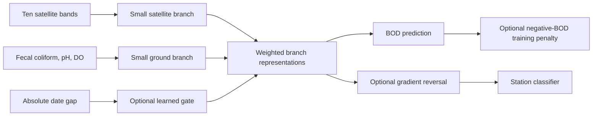

# Small switchable experimental network

This is a separate CPU PyTorch demonstration. It adds a learned date-gap gate, a nonnegative-BOD training penalty, and a station-adversarial classifier to one small two-branch model. The working scikit-learn models remain unchanged. Each mechanism has an independent on/off switch; improvement is not a completion requirement.

## What happens



Both branches have four tanh outputs. Their weighted representations are concatenated into an eight-value vector, then a 4-neuron tanh head and linear output estimate BOD. The network has 130 total parameters including optional heads; disabled heads remain stored but receive no gradient. Fecal coliform is log1p-transformed. All 13 numeric predictors are standardized with training-only means and standard deviations. Station ID is never a prediction input.

### Temporal gate

With the gate enabled, `sigmoid(a * abs(date_gap)/7 + b)` supplies the satellite weight; `1 - weight` supplies the ground weight. Parameters `a` and `b` are learned through BOD training. They start at -1 and 0, giving older imagery a lower initial satellite weight. Training may change that relationship; it is not an imposed law or calibrated confidence score. When disabled, each branch has fixed weight 0.5.

`gate_sweep.csv` holds the readings constant for one example and changes the date gap from zero to seven days. The saved learned gate assigns decreasing satellite weights in this run. `gate_weights.png` makes that behavior visible. Both enabled runs changed gate parameters during training.

### Basic training constraint

The added term is `mean(relu(-raw_BOD)^2)`, with weight 1.0. Its gradient pushes negative raw predictions upward. It is part of training when enabled; it is zeroed out of the total loss when disabled. The term was active for 29 epochs in the constraint-only refit and 27 in the all-components refit.

This is a simple physical-consistency constraint, not a differential-equation physics-informed neural network. All variants clip negative predictions to zero at inference for consistency, but raw predictions and raw-negative counts are saved, so inference clipping does not conceal the penalty's behavior. No variant had negative raw BOD on the saved test set. The penalty becomes inactive when training predictions are nonnegative.

### Station-adversarial component

A small classifier predicts which of the three stations produced a training observation. The classifier learns normally, but a gradient-reversal layer sends the opposite gradient back to the shared representation, encouraging the representation to be less station-specific while retaining BOD information. This uses the mechanism described in [Domain-Adversarial Training of Neural Networks](https://jmlr.org/papers/v17/15-239.html), adapted as station-adversarial regularization rather than source-to-target foreign-river adaptation.

Class-balanced station cross-entropy has weight 0.1. Reversal strength follows a fixed smooth ramp from near zero toward 0.2 across the configured maximum training schedule. The classifier is trained only on the fitting subset's station labels. Test features, station labels and BOD answers do not enter optimization. Disabled mode skips the classifier loss and leaves its weights unchanged.

The saved classifier still identified training stations with roughly 99% accuracy in the adversarial-only run and 96% with all components. Consequently, the component demonstrably runs but has not achieved strong station invariance. No domain-generalization improvement is claimed. All three sites are on the Ganga; this is not cross-country testing.

## Identical data and independent switches

The existing enriched 100-row dataset and fixed 80/20 chronological assignments are reused. Each variant selects its training duration using a separated chronological 60/20 split inside the outer 80 training examples. It trains for up to 400 epochs during selection, picks the minimum validation MAE, then refits from seed 42 on all 80 rows for that duration. The reversal ramp uses the same configured maximum schedule during selection and refit. No test-based epoch selection is performed.

Adam uses learning rate 0.01 and weight decay 0.001. All variants share branch sizes, initialization recipe and preprocessing. The five saved runs cover all switches off, each switch alone, and all three together; this is not an exhaustive eight-combination study.

| Variant | Selected refit epochs | Test n | MAE (mg/L) | RMSE (mg/L) |
|---|---:|---:|---:|---:|
| Baseline: all switches off | 142 | 20 | 0.3211 | 0.4386 |
| Gate only | 127 | 20 | 0.2799 | 0.3630 |
| Constraint only | 142 | 20 | 0.3221 | 0.4392 |
| Station adversarial only | 141 | 20 | 0.3252 | 0.4417 |
| All components | 126 | 20 | 0.2827 | 0.3652 |
| Training-average reference | — | 20 | 1.0054 | 1.0440 |

The gate helped on this sample. The constraint and adversarial component did not improve their individual test scores. The all-components model was not better than gate-only. These previously examined same-station cases remain exploratory; neither the best variant nor a new main predictor is automatically selected from test results.

## Run on Windows

Use the existing `.venv-check` environment, or standard Python 3.12/3.13. For a fresh environment, install CPU PyTorch first:

```powershell
.\.venv-check\Scripts\python.exe -m pip install torch==2.14.1 --index-url https://download.pytorch.org/whl/cpu
.\.venv-check\Scripts\python.exe -m pip install -r requirements-experimental.txt
.\.venv-check\Scripts\python.exe scripts/restore_demo_bundle.py
```

Reproduce the five saved demonstrations into a fresh directory:

```powershell
.\.venv-check\Scripts\python.exe scripts/run_experimental_network.py --suite --output outputs/experimental_reproduction
```

For a custom combination, use the switches explicitly:

```powershell
.\.venv-check\Scripts\python.exe scripts/run_experimental_network.py --gate --constraint --no-station-adversarial --output outputs/experimental_gate_constraint
```

Each flag also supports its `--no-...` form. Without `--suite`, all three default to off. `--suite` runs its five fixed combinations. Output paths must be new; saved files are never replaced. No CUDA, new Earth Engine extraction or new US data are required.

## Saved model and charts

Artifacts are under `outputs/experimental_network_20261014/`, with byte-preserved copies in `demo_bundle/files/outputs/experimental_network_20261014/`:

- Five `.pt` checkpoints containing switches, scalers, parameters and selected durations.
- Test predictions with raw BOD, clipped BOD, branch weights and errors.
- Refit training histories containing BOD loss, applied penalty, station loss/accuracy and reversal strength.
- Inner validation histories, inner/outer assignments, test metrics and `run.json` with hashes.
- `comparison.png`, `gate_weights.png`, `training_losses.png`, and `station_adversarial_loss.png`.

Inference requires ten satellite bands, fecal coliform, pH, dissolved oxygen, and `temporal_offset_days`. BOD and station identity can be omitted:

```python
import pandas as pd
import torch
from river_water_quality.training.experimental_network import predict_network

checkpoint = torch.load("outputs/experimental_network_20261014/all_components.pt",
                        map_location="cpu", weights_only=True)
rows = pd.read_csv("outputs/india_100_chemical_dataset_20261014/paired.csv")
result = predict_network(checkpoint, rows)
print(result["predicted"])
```

This experimental network requires ground readings; it does not replace the satellite-only coordinate/image demonstration. The source/QC/time/coordinate and bank/bridge/SCL assumptions remain documented in the prepared dataset.

## Verification

Focused tests check the reversal gradient sign/strength, penalty direction, gap-sensitive gate versus fixed off behavior, inactive-head weights, and inference without target/station labels. Saved checkpoint reloads reproduce predictions. Enabled gate and station-head parameters change. Training penalties and ineffective results are retained. Both previous scikit-learn model hashes remain unchanged.
