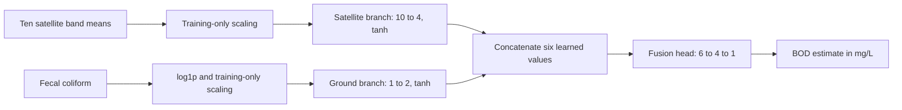

# Functionality 2: dual-branch fusion proof of concept

The model is implemented, trained on the existing real paired dataset, saved,
and runnable offline. It estimates same-event BOD in mg/L using ten Sentinel-2
band means and measured fecal coliform. The measured BOD answer is never an input.

## Architecture



Both branches have independent trainable weights and receive gradients through
the shared prediction loss. The 81-parameter network uses tanh hidden activations
and a softplus output, keeping predicted BOD nonnegative. This is an ordinary output
activation, not implementation of the separate physics-informed functionality.
The satellite branch processes extracted image features, not a raw-image CNN.
The ground branch currently has one available predictor, fecal coliform in
MPN/100mL. No missing chemistry is fabricated. Station identifiers, dates,
coordinates and quality flags are metadata, not learned predictors.

## Real run

Input: `outputs/hybrid_demo_001/{matches,ground,satellite}.csv`, with source report
and recorded hashes. The existing dataset builder validates event links and units.
All 14 complete pairs are used, with the following chronological split based on
both sampling and image dates and a seven-day boundary gap:

| Split | Period | Events |
|---|---|---:|
| Training | January and March 2021 | 6 |
| Validation | May through September 2021 | 5 |
| Test | November 2021 | 3 |

Scaling is fitted only on training features. Ground values use log1p before
standardization. Training uses full-batch Adam, learning rate 0.01, weight decay
0.001, MSE loss, seed 42, and a maximum of 500 epochs. A patience of 60 epochs
can stop training. The saved weights come from the lowest validation MAE,
epoch 454 in this run. There is no validation refit and no test-based tuning.
Shared scene/acquisition aliases across retained splits are rejected.

| Method | Validation MAE (mg/L), n=5 | Test MAE (mg/L), n=3 |
|---|---:|---:|
| Dual-branch fusion | 0.1750 | 0.5864 |
| Training-average reference | 1.2700 | 0.8500 |
| Ground-only Ridge | 0.3828 | 1.0043 |
| Satellite-only Ridge | 1.0107 | 0.9201 |

Each Ridge comparison has fixed alpha=1 and training-only scaling. The ground-only
comparison uses the same log1p fecal-coliform transformation. These comparisons
provide context; they do not select or replace the requested fusion architecture.
Ridge outputs are unconstrained and were not clipped after evaluation.

Actual held-out predictions:

| Station | Actual BOD | Fusion estimate | Absolute error |
|---|---:|---:|---:|
| Varanasi downstream | 3.5 | 3.5450 | 0.0450 |
| Anoopshahar upstream | 2.3 | 0.6881 | 1.6119 |
| Bijnor barrage | 1.2 | 1.3024 | 0.1024 |

All values are mg/L. Test RMSE is 0.9329 mg/L and R2 is 0.0135. The large
Anoopshahar error is retained and reported. Three test cases cannot establish
reliability, superiority, an uncertainty interval, or regional generalization.
With 81 parameters and just six fitting examples, overfitting is a serious
limitation; these results demonstrate functioning software and the architecture.

## Teacher demonstration

Use the correct working copy and its existing environment:

```powershell
cd "C:\Users\Lakshyajeet\Desktop\clone of dbs project\River-Water-Quality-Prediction"
.\.venv-check\Scripts\python.exe scripts/fusion.py predict --output outputs/fusion_demo_001/my_predictions.csv
```

The defaults load `outputs/fusion_demo_001/model.pt` and
`outputs/fusion_demo_001/example_inputs.csv`. The example CSV has the three test
events' satellite features and fecal coliform, with **no BOD answers**. The command
prints their estimated BOD values and writes the output CSV. Use a new output
filename on subsequent runs. No Earth Engine connection is needed for prediction.

Compare predictions against `test_predictions.csv`, which separately contains
the actual answers and baseline predictions. Inspect `split_assignments.csv` for
the exact partition and `training_history.csv` for epoch losses. `report.json`
contains units, architecture, metrics, original input report, hashes, and limitations.
Saved-model prediction has been checked against the held-out evaluation output.

All 205 software tests passed, including branch-gradient checks, target-leakage
rejection, training-only scaling, invariance of training to altered test targets,
shared-scene rejection, safe checkpoint reload, and the train/predict CLI round trip.
Installed dependencies pass pip check. The real checkpoint contains changed weights
in both encoders and the fusion head compared with their seeded initialization.

To retrain into a fresh directory:

```powershell
.\.venv-check\Scripts\python.exe scripts/fusion.py train --data outputs/hybrid_demo_001 --output outputs/fusion_demo_002
```

To use another input CSV, pass `--input path.csv` and `--model path/model.pt`.
Required columns are `satellite_B2`, `satellite_B3`, `satellite_B4`, `satellite_B5`,
`satellite_B6`, `satellite_B7`, `satellite_B8`, `satellite_B8A`, `satellite_B11`,
`satellite_B12`, and `ground_fecal_coliform`. Values must use the units above.
Optional metadata columns are carried to the output; other columns, including
any BOD target, are not used as features. Missing/invalid inputs fail explicitly.

## Setup on another machine

CPU-only PyTorch is installed in this workspace. For a fresh environment:

```powershell
python -m pip install "torch>=2.6,<3" --index-url https://download.pytorch.org/whl/cpu
python -m pip install -r requirements-fusion.txt
```

The checkpoint contains a state dictionary and plain preprocessing metadata.
Loading uses CPU mapping and `weights_only=True`, following the
[PyTorch save/load pattern](https://docs.pytorch.org/tutorials/beginner/basics/saveloadrun_tutorial.html).
Dataset and model artifacts are ignored by Git and must be regenerated or copied
separately for a teacher's machine. Synthetic fixtures test the software and are
not used to report the real results above.

## What this completes

This demonstrates report functionality 2 alongside the existing satellite-ground
matching demonstration. It requires same-event fecal-coliform measurements and
retrospectively matched imagery, so it is not a forecast or a predictor for places
without laboratory data. The separate historical BOD MVP is a different workflow.
Source provenance/QC/time assumptions and possible bridge/bank mixtures from the
hybridization dataset still apply. The other six report functionalities remain
outstanding; this implementation does not add them.
