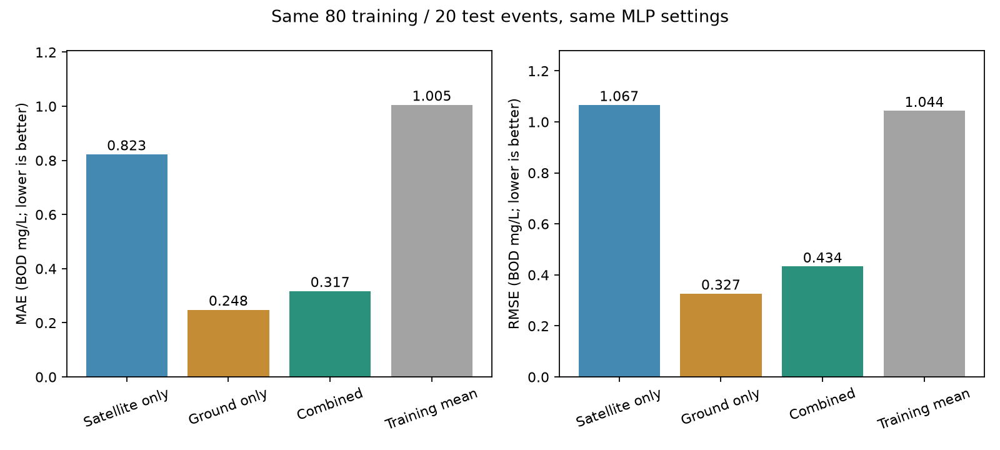

# Ground-only versus satellite-only versus combined

Completed the missing trained ground-only baseline. All three models predict BOD on exactly the same saved 20 test observations, with the same 80 training observations and preprocessing/training settings. Existing models and predictions were preserved and hash-verified.

## Results

| Model | Inputs | Test observations | MAE, mg/L | RMSE, mg/L | R2 |
|---|---|---:|---:|---:|---:|
| Satellite-only | Ten Sentinel-2 bands | 20 | 0.8225 | 1.0669 | -0.0750 |
| Ground-only | Fecal coliform, pH, dissolved oxygen | 20 | 0.2484 | 0.3273 | 0.8988 |
| Combined, all chemicals | Same ten bands plus same three ground parameters | 20 | 0.3173 | 0.4336 | 0.8224 |
| Training mean | Constant mean BOD from the 80 training cases | 20 | 1.0054 | 1.0440 | -0.0293 |

**Ground-only performed best among these three fixed models.** The combined model's MAE is 0.06885 mg/L higher, about 27.7% higher than ground-only. Ground-only has lower absolute error on 12 cases; combined has lower error on 8. Thus adding satellite bands did not improve this fixed all-input model on this test cohort. This is a valid comparison result, not a reason to alter or hide predictions.

The previously selected-feature model is a separate feature-selection experiment; it is not substituted for the fixed full-input model to change this comparison's conclusion.

## Fairness and saved models

- Ground-only uses the existing friend's model type: MLPRegressor, one hidden layer with eight ReLU neurons, L-BFGS, alpha 1.0, max_iter 3000, seed 42.
- Fecal concentration is log1p-transformed. Input and target scalers are fitted only to the 80 training cases. Outputs are inverse-scaled to mg/L and clipped to zero like the existing models.
- BOD is the target, never a predictor. Ground-only inference requires just fecal coliform, pH and DO; no satellite bands, BOD labels, dates or station IDs enter prediction.
- Satellite-only and combined models are loaded from saved artifacts, not retrained. Their predictions reproduce the previous comparison to numerical tolerance. The original split, target values and test identities are checked explicitly.
- The new model converged in 133 iterations with no captured training warnings. Its saved joblib reload reproduced predictions.

Same settings do not imply equal parameter counts: models have 10, 3 and 13 inputs. No tuning or selection used the test outcomes. The main saved satellite-only predictor remains unchanged.

## Station breakdown and interpretation

| Station | Test n | Ground-only MAE | Combined MAE |
|---|---:|---:|---:|
| Varanasi, Malviya Bridge | 7 | 0.3625 | 0.6155 |
| Anupshahar | 6 | 0.2185 | 0.2365 |
| Bijnor barrage | 7 | 0.1601 | 0.0884 |

The combined model helps Bijnor but not the other two stations here. These are known training stations, not held-out locations. Only 20 previously examined observations are available. Strong aggregate R2 can reflect differences between station ranges; within-station R2 is negative in these tiny, low-variance subsets. Do not claim proven cross-station generalisation or overall water-quality prediction from these numbers.

The result suggests ground measurements carry most useful information for this small BOD task. Unseen-station testing remains the next independent assessment. It is not implemented in this step.

## Files and reproduction

Results: `outputs/ground_only_comparison_20261014/`. The new model and all eight artifacts are preserved in [the demo bundle](../demo_bundle/files/outputs/ground_only_comparison_20261014/).

- `ground_only.joblib`: new saved model; existing models are untouched.
- `ground_only_example_inputs.csv`: the 20 ground-only inputs without BOD labels.
- `metrics.csv`, `station_metrics.csv`: overall and station-level metrics.
- `test_predictions.csv`: actual BOD and all predictions/errors on identical examples.
- `split_assignments.csv`: unchanged 80/20 assignments.
- `run.json`: input/model/output hashes, settings, features and limitations.
- `modality_comparison.png`: chart, visually verified.



From the repository root:

```powershell
.\.venv-check\Scripts\python.exe scripts/restore_demo_bundle.py
.\.venv-check\Scripts\python.exe scripts/compare_ground_only.py --output outputs/ground_only_reproduction
```

The script requires `requirements-demonstrations.txt` and refuses to overwrite an existing directory. No Google login, imagery downloads or GPU are needed. Reproduction trains only the new ground-only model with fixed settings.

Verification: five focused comparison/preprocessing tests passed, new checkpoint reload reproduced predictions, existing model/data hashes remained unchanged, and all 151 bundle files verified. The notebook has not yet been updated to include this new baseline.
