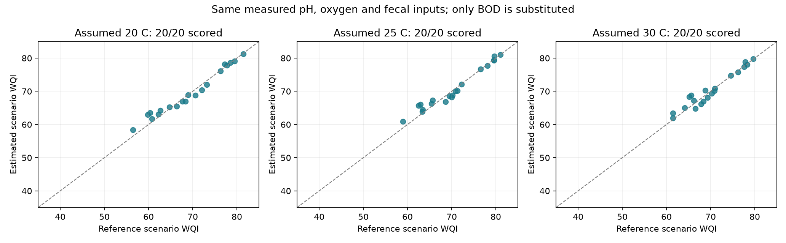
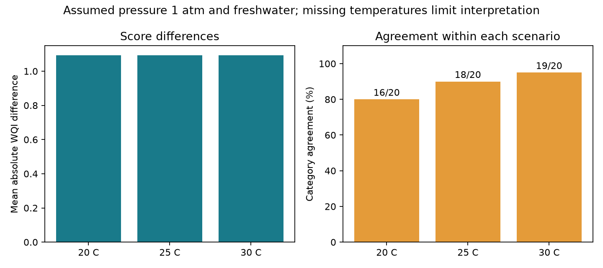

# WQI substitution evaluation (step 4)

Evaluated the unchanged saved satellite-only BOD model on its original 20 chronological test observations. All source files were checked against the saved bundle hashes. Reloaded-model predictions reproduced saved predictions within 1e-7 mg/L. No training, model selection or test-set changes occurred.

For each observation, reference scenario WQI uses measured BOD, pH, oxygen and fecal concentration. Estimated scenario WQI replaces only BOD with the saved prediction. Both use exactly the same assumed conditions: temperature 20, 25 or 30 C, pressure 1 atmosphere, salinity 0. These are **assumption-based reference and estimated scores**, not independently measured WQI labels.

## Results

| Assumed temperature | Scored / attempted | Mean absolute WQI difference | WQI RMSE | Category agreement | Training-mean BOD baseline agreement |
|---|---:|---:|---:|---:|---:|
| 20 C | 20/20 | 1.094 | 1.419 | 16/20 (80%) | 18/20 (90%) |
| 25 C | 20/20 | 1.094 | 1.419 | 18/20 (90%) | 18/20 (90%) |
| 30 C | 20/20 | 1.094 | 1.419 | 19/20 (95%) | 18/20 (90%) |

The baseline substitutes the training-set mean BOD (2.30125 mg/L) while retaining the same measured pH/DO/fecal values. Its WQI MAE is 1.337 and RMSE 1.389 in each scenario. The model has lower mean absolute error but slightly higher RMSE, so it does not outperform this baseline on every measure. This is not a fitted ground-only model.

The same 20 events are supported in all scenarios; no event was removed. The calculator still reports exclusions explicitly if future input conditions produce unsupported saturation or missing values.

## What the comparison establishes

- The downstream WQI calculation works with the frozen model and real matched station measurements.
- In these cases, BOD values lie within the index's linear 0-10 mg/L interval. A 1 mg/L BOD error changes WQI by 1.33 points. Tests and evaluation check this relationship.
- Consequently WQI error stays identical across temperatures when both scores share the same oxygen calculation. Category agreement can still change because the common oxygen term shifts scores across category boundaries.
- Six reference categories and three estimated categories change somewhere across the temperature scenarios. The sweep is not a confidence interval and does not resolve unknown actual water temperature.

## Limits for the presentation

The other three measurements account for 81% of the index weight and are shared by reference and estimated scores. High agreement therefore does not show that satellite imagery independently predicts overall water quality. It checks only substitution of estimated BOD into this formula.

Reference categories contain only Good and Good-Excellent: 6/14 observations at 20 C, 3/17 at 25 C, and 2/18 at 30 C. No Poor or Very Poor reference cases are present. The evaluation cannot establish detection of polluted-water categories. Always choosing the majority reference category would agree on 70%, 85% and 90% respectively; these are descriptive test-set proportions, not a fitted classifier baseline.

Rounded published equations produce sub-indices slightly above 100 in 5, 7 and 2 observations respectively. These are retained as `formula_warning`, explicitly counted, and included in reported metrics. They are not silently clipped or excluded. Actual water temperature/pressure, laboratory QC, and equivalence of source MPN estimates to the index's reported counts remain unverified.

The test examples were already examined in earlier demonstrations. This is exploratory internal evaluation on three known Ganga stations, not a fresh external or cross-regional validation, drinking-water safety assessment or proof of prediction from coordinates alone.

## Saved evidence

Under [wqi_evaluation_results](wqi_evaluation_results/):

- [20 test inputs](wqi_evaluation_results/test_inputs.csv).
- [60 scenario comparisons](wqi_evaluation_results/wqi_predictions.csv), including each score, category, status, assumption and BOD contribution.
- [Metrics and baseline](wqi_evaluation_results/metrics.csv).
- [Category confusion counts](wqi_evaluation_results/category_confusion.csv).
- [Temperature category stability](wqi_evaluation_results/temperature_category_stability.csv).
- [Provenance and hashes](wqi_evaluation_results/provenance.json).





Both charts have been visually checked. Use the baseline table above alongside the model-only chart.

## Reproduce

From the repository root, after restoring the demo bundle and installing `requirements-demonstrations.txt`, choose a fresh output directory:

```powershell
.\.venv-check\Scripts\python.exe scripts/evaluate_wqi.py --output outputs/wqi_evaluation_reproduction
```

No satellite downloads, Google login or retraining are required. Four focused evaluation tests check the exact test cohort/order, rejection of training-case substitution, rejection of changed reference BOD and exclusion of unsupported rows from metric denominators. All 31 WQI/audit/evaluation tests passed.

Step 5 remains: incorporate these results, assumptions and limitations into the demonstration notebook. Nothing in this step changes notebook outputs.
